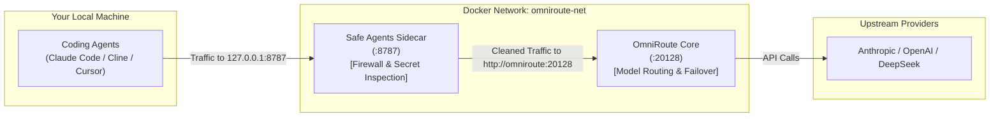

If you use **OmniRoute** to manage and route AI coding models, you already appreciate having a unified gateway. You point Claude Code, Cline, Cursor, or OpenCode to one local endpoint, and OmniRoute handles upstream balancing, fallbacks, and provider switching.

But as AI coding agents become more autonomous—reading local project files, running terminal commands, and making network calls—a serious headache emerges: **security and data exfiltration**.

What stops an agent from accidentally dumping your `.env` secrets, database passwords, or private source code into an external prompt?

Enter **Safe Agents**: a lightweight firewall proxy designed specifically to intercept agent traffic, block secret leaks, and audit payloads before they leave your machine.

The dream setup is simple: **Agent ➔ Safe Agents (Firewall) ➔ OmniRoute (Gateway) ➔ LLM APIs**.

Chaining them together does not require hacky scripts, host-level Python installs, or complex network bridges. Actually, OmniRoute’s architecture is already built for this if we avail of **Docker Compose Profiles**.

---

## Why Docker Compose Profiles Are the Sweet Spot

OmniRoute’s `docker-compose.yml` already leverages Docker Compose profiles to spin up optional sidecars alongside the core gateway:
- `base`: Core OmniRoute gateway.
- `cli`: Containerized developer tools (Codex, Claude Code, OpenClaw).
- `cliproxyapi`: Companion proxy service running on port 8317.

Because maintainers already established this pattern, adding a `--profile safeagents` sidecar fits their architecture like a glove.

Instead of juggling multiple detached Docker containers or trying to cope up with installing `uv` and Python packages on your bare host machine, you get a clean, one-liner startup:

```bash
docker compose --profile base --profile safeagents up -d
```

With just one command, the entire protected stack is up and running.

---

## The Architecture: How It Fits Together

In OmniRoute's Docker environment, services communicate across an isolated internal Docker bridge network (`omniroute-net`). The main gateway is reachable internally at `http://omniroute:20128`.



Here is a clean setup wherein the sidecar handles the security layer:
1. **Internal Upstream Targeting:** Safe Agents sits on the internal Docker network, forwarding upstream traffic to `http://omniroute:20128`. That means OmniRoute does not even have to expose port 20128 to your host machine in the first place if you want to lock down ports completely.
2. **Host Ingress:** Safe Agents exposes `127.0.0.1:8787:8787` to your host machine. You configure your IDE extensions and coding CLIs to hit `http://127.0.0.1:8787` instead of calling OmniRoute directly.
3. **Rule & Log Persistence:** A mounted local directory allows you to drop in custom Python inspection rules (like the `.env` exfiltration blocker, as per recent demos) and persist audit logs across container recreations.

---

## The Ready-to-Use Docker Compose Snippet

Whether you want to drop this directly into a `docker-compose.override.yml` for your local rig today or submit it upstream as a PR, here is the drop-in service definition:

```yaml
services:
  safeagents:
    image: python:3.12-slim
    profiles: ["safeagents"]
    container_name: omniroute-safeagents
    working_dir: /app
    command: >
      sh -c "pip install -q uv && uv tool install safeagents &&
      /root/.local/bin/safeagents http://omniroute:20128 --host 0.0.0.0 --port 8787"
    ports:
      - "127.0.0.1:8787:8787"
    volumes:
      - safeagents-data:/root/.safeagents
      # Optional: mount custom Python rules (e.g., .env exfiltration blocker)
      # - ./safeagents-plugins:/plugins:ro
      # - ./safeagents_rules.py:/app/rules.py:ro
    depends_on:
      - omniroute
    restart: unless-stopped

volumes:
  safeagents-data:
```

> [!NOTE]
> **Why `--host 0.0.0.0` is required inside the container:**
> By default, Safe Agents binds strictly to loopback (`127.0.0.1`). Inside a container, loopback only listens to traffic from inside that specific container. Passing `--host 0.0.0.0` allows Docker's port-mapping engine to forward inbound traffic from your host's `127.0.0.1:8787` into the service. Because the Compose file binds port `8787` explicitly to `127.0.0.1` on the host, your firewall proxy remains unreachable from the outside network.

---

## The Big Wins

### 1. Zero Host Clutter
No need to ensure Python 3.10+, `pip`, or `uv` are installed on your host OS. Everything runs inside a lightweight `python:3.12-slim` image, keeping your local dev machine clean.

### 2. Natural Fit for Existing OmniRoute Users
OmniRoute users are already accustomed to spinning up sidecars via Compose profiles. Chaining an AI firewall shouldn't feel like hacking a foreign tool into your setup—it should feel like flipping a native toggle.

### 3. Frictionless Integration with `omniroute-cli`
If you use OmniRoute’s containerized CLI profile (`docker compose --profile cli up -d`), those bundled agents (Claude Code, Codex, OpenClaw) don't even have to leave Docker to reach the firewall. They target `http://safeagents:8787` directly across the internal network.

### 4. Defense-in-Depth for Autonomous Coding
Placing a dedicated proxy inspection layer right in front of your gateway ensures that privacy rules, regex filters, and rate limits happen automatically—without having to configure guardrails separately inside every single IDE extension or CLI tool.

---

## Verdict

Bottomline is, chaining Safe Agents into OmniRoute through Docker Compose profiles bridges the gap between **model routing convenience** and **data security**. It gives you a zero-maintenance, single-command proxy pipeline that protects your credentials before a single token reaches the cloud.
